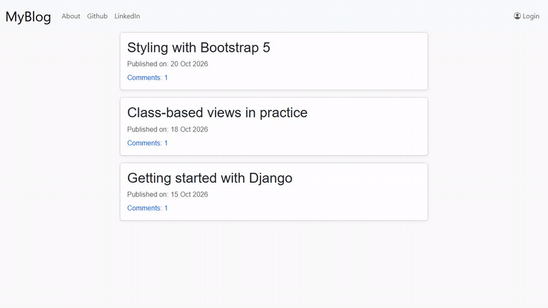
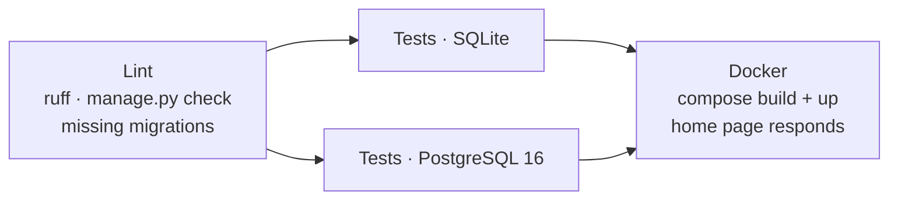
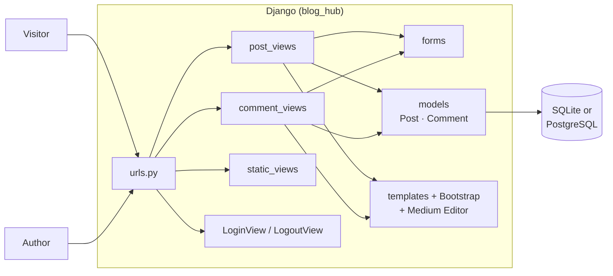
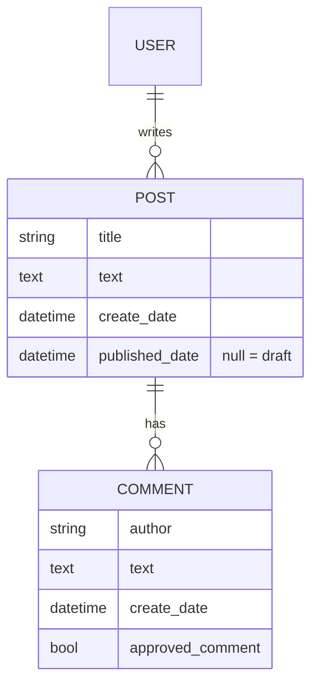

<div align="center">

# 📝 Minimal Blog

[](https://github.com/pero-grubac/Minimal-blog/actions/workflows/ci.yml)


**A small Django blog: write posts in a rich-text editor, keep them as drafts, publish them, and moderate visitors' comments.**



</div>

---

## 📌 Project Overview

**Minimal Blog** is a blog built with Django and Bootstrap 5. The author writes posts in the [Medium Editor](https://github.com/yabwe/medium-editor), saves them as drafts and publishes them when they are ready. Visitors read the published posts and leave comments, which appear only after the author approves them.

There are two kinds of visitor:

| Who | How they get in | What they can do |
|-----|-----------------|------------------|
| 🌍 **Visitor** | Nobody signs in | Read published posts, see approved comments, leave a comment |
| ✍️ **Author** | Username and password (`/accounts/login/`) | Everything above, plus write, edit, publish and delete posts, see drafts, approve or remove comments |

---

## ✨ Features

- ✍️ **Rich-text posts** written in the Medium Editor
- 🗂️ **Drafts**: a new post is a draft until it is published, and drafts are visible only to logged-in users
- 🚀 **Publishing** with one click; the home page lists published posts, newest first
- 💬 **Comments** from anyone, with **moderation**: a comment stays hidden until it is approved
- 🔐 **Safe by default**: actions that change data only accept `POST` with a CSRF token, comment text is always escaped, and the post author is always the logged-in user
- 🛠️ **Django admin** for posts, comments and users
- 🐳 **Docker Compose** setup with PostgreSQL, or plain SQLite for local development
- ✅ **90 tests** with 99% coverage, run in CI on SQLite and PostgreSQL

---

## 🛠️ Tech Stack

| Technology | Usage |
|------------|-------|
| Python 3.12 + Django 5.1 | Web framework, ORM, auth, admin |
| SQLite / PostgreSQL 16 | Database (SQLite locally, PostgreSQL in Docker) |
| Bootstrap 5.3 + Bootstrap Icons | Layout and styling |
| Medium Editor | Rich-text editor for posts |
| python-dotenv | Configuration from a `.env` file |
| Django test framework + coverage | Tests |
| Ruff | Linting |
| Docker + Docker Compose | Containerized app and database |
| GitHub Actions | CI: lint, tests on two databases, Docker smoke test |

---

## 📁 Repository Structure

```
Minimal-blog/
├── blog_hub/                     Django project
│   ├── blog/                     the blog app
│   │   ├── models.py             Post, Comment
│   │   ├── forms.py              PostForm, CommentForm
│   │   ├── views/                post_views, comment_views, static_views
│   │   ├── templates/blog/       pages (list, detail, form, drafts, about)
│   │   ├── static/css/blog.css   custom styles
│   │   └── tests/                unit and view tests
│   ├── blog_hub/                 settings, root URLs, WSGI/ASGI
│   ├── templates/registration/   login page
│   ├── manage.py
│   ├── requirements.txt          runtime dependencies
│   ├── requirements-dev.txt      + coverage, ruff
│   ├── pyproject.toml            ruff and coverage config
│   ├── .env.example              configuration template
│   ├── Dockerfile
│   └── docker-compose.yml        app + PostgreSQL
├── readme_assets/demo.gif
└── .github/workflows/ci.yml      CI pipeline
```

---

## 🚀 Installation

### Prerequisites
- Python 3.12
- Git
- Docker Desktop (only for the Docker option)

### 1. Clone the repository
```bash
git clone https://github.com/pero-grubac/Minimal-blog.git
cd Minimal-blog/blog_hub
```

### Option A: Local (SQLite)

#### 2. Create a virtual environment and install dependencies
```bash
python -m venv .venv

# Windows
.venv\Scripts\activate
# macOS / Linux
source .venv/bin/activate

pip install -r requirements-dev.txt
```

#### 3. (Optional) Configure
```bash
cp .env.example .env
```

Without a `.env` the app runs on SQLite in debug mode, which is all you need locally. The variables are listed under **Configuration** below.

#### 4. Create the database and an author account
```bash
python manage.py migrate
python manage.py createsuperuser
```

#### 5. Start the server
```bash
python manage.py runserver
```

Open **http://127.0.0.1:8000**.

### Option B: Docker (PostgreSQL)

```bash
cd blog_hub
docker compose up -d --build
docker compose exec web python manage.py createsuperuser
```

The app is at **http://localhost:8000**. Migrations run on start, and PostgreSQL data is kept in the `postgres_data` volume. Stop it with `docker compose down` (add `-v` to delete the data too).

---

## 📖 Usage

| Page | Address | Who |
|------|---------|-----|
| Published posts | `/` | everyone |
| Single post | `/post/<id>/` | everyone (drafts: logged in only) |
| Add a comment | `/post/<id>/comment/` | everyone |
| About | `/about/` | everyone |
| Log in / out | `/accounts/login/` | everyone |
| New post | `/post/new/` | logged in |
| Drafts | `/drafts/` | logged in |
| Edit / delete post | `/post/<id>/edit/`, `/post/<id>/remove/` | logged in |
| Admin | `/admin/` | staff users |

### Writing and publishing a post
1. Log in with the account from `createsuperuser` (**Login** in the navbar).
2. Click **New Post**, enter a title and write the text in the editor. Select text to get the formatting toolbar (bold, italic, headings, links, quotes).
3. **Save** stores the post as a draft and opens **Drafts**.
4. Open the draft and click **Publish**. It now appears on the home page.

Use the ✏️ and 🗑️ buttons on a post to edit or delete it.

### Moderating comments
1. A visitor opens a post, clicks **Add Comment** and submits their name and text.
2. The comment is hidden from visitors. When you are logged in it is shown on the post with two buttons: ✔️ **approve** and 🗑️ **remove**.
3. Once approved, it is visible to everyone and counted on the home page.

---

## ⚙️ Configuration

Settings are read from environment variables, or from `blog_hub/.env` (see [`.env.example`](blog_hub/.env.example)):

| Variable | Default | Description |
|----------|---------|-------------|
| `DJANGO_SECRET_KEY` | an insecure development key | **Set a long random value in production** |
| `DJANGO_DEBUG` | `True` | `False` in production |
| `DJANGO_ALLOWED_HOSTS` | `localhost,127.0.0.1` | Comma-separated host names |
| `DB_ENGINE` | *(empty → SQLite)* | `postgres` to use PostgreSQL |
| `DB_NAME` / `DB_USER` / `DB_PASSWORD` | `blog_db` / `blog_user` / `blog_password` | PostgreSQL credentials |
| `DB_HOST` / `DB_PORT` | `localhost` / `5432` | `db` inside Docker Compose |

---

## ✅ Tests

```bash
cd blog_hub
python manage.py test                       # run all tests
coverage run manage.py test && coverage report   # with coverage
ruff check .                                # lint
```

The tests are in [`blog_hub/blog/tests/`](blog_hub/blog/tests/):

| File | Covers |
|------|--------|
| `test_models.py` | Publishing, comment approval, URLs, cascading deletes |
| `test_forms.py` | Validation, no `author` field, plain-text comments |
| `test_post_views.py` | List, detail, create, edit, delete, drafts, publish, login rules, draft privacy |
| `test_comment_views.py` | Commenting, moderation, visibility, HTML escaping, `POST`-only actions |
| `test_pages.py` | About page, navbar, login/logout, admin |

To run them against PostgreSQL, start the database (`docker compose up -d db`) and set `DB_ENGINE=postgres`.

---

## 🔄 CI/CD

[`.github/workflows/ci.yml`](.github/workflows/ci.yml) runs on every push to `main` and on every pull request:



- **Lint**: Ruff, Django's system checks, and a check that no model change is missing a migration
- **Tests**: the whole suite on SQLite and on a PostgreSQL service container, with coverage that must stay at **90%** or more (the report is uploaded as an artifact)
- **Docker**: builds the image, starts the stack with `docker compose` and checks that the home page answers

---

## 🏗️ Architecture





---

## 🧭 Design Decisions

- **A draft is a post without a `published_date`.** No separate status field, and the home page only shows posts whose date is in the past.
- **Comments are open, moderation is not.** Anyone can comment, but only logged-in users see unapproved comments and can approve or remove them.
- **Changes only through `POST`.** Publishing, approving and removing are forms with a CSRF token, so a link or a crawler can't trigger them.
- **Untrusted text is never rendered as HTML.** Posts (written by logged-in authors) keep the editor's formatting; comments from visitors are always escaped.
- **One settings file, configured by the environment.** The same code runs on SQLite locally and on PostgreSQL in Docker and CI.

---

## 🎨 Credits

- [Medium Editor](https://github.com/yabwe/medium-editor) by Yabwe, the rich-text editor
- [Color-changing CSS animation](https://codepen.io/thapliyalshivam/pen/dvgXVO) by Shivam Thapliyal, the inspiration for the animated titles

## 📄 License

See [LICENSE](LICENSE).
